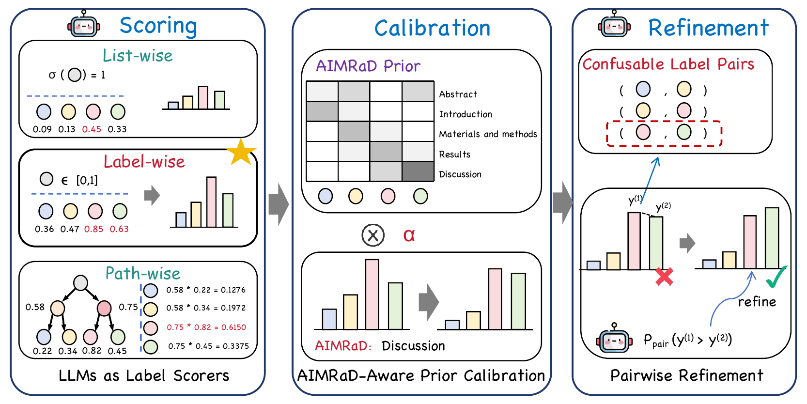

<h1 align="center">OPINE: A Prior-calibrated Scoring Framework for LLM-based Multi-label Scientific Opinion Classification</h1>

<p align="center">
  Mengting Zhang · Gaofeng Pan · Zhixiong Zhang · Yang Li · Guangyin Zhang<br>
  <em>Findings of ACL 2026</em>
</p>

<p align="center">
  <a href="https://aclanthology.org/2026.findings-acl.1617/">&nbsp;Paper</a>
  &nbsp;·&nbsp;
  <a href="https://github.com/znoodle63/OPINE">&nbsp;Code</a>
</p>

## Overview

OPINE classifies scientific opinion sentences into one or more of 18 discourse-function labels. It combines label-wise LLM scores, AIMRaD prior calibration, pairwise refinement for confusable labels, and quantile decoding. The [dataset](data/) contains 3,975 training sentences and 1,049 test sentences, split by paper.

<p align="center">
  
  <br>
  <em>Figure 2 from the paper. Overview of the OPINE framework.</em>
</p>

## Quick start

### 1. Install dependencies

Run from the repository root.

```bash
python3 -m pip install -r requirements.txt
```

### 2. Configure and check the API

Set your provider's `model` and `base_url` in [config.json](config.json). For first-time setup, create a local `.env` file with `export OPINE_API_KEY='<your-api-key>'`.

```bash
source .env
./run_opine.sh --check-api
```

### 3. Reproduce the experiments

After the API check passes, each experiment can be run independently. To reuse results across scripts, keep the model, API endpoint, output directory, and context setting the same. Add `--no-context` to any of the three scripts to use only the target sentence.

| Command | Experiment | When to run | Outputs and reuse |
| --- | --- | --- | --- |
| `./run_opine.sh` | Evaluate the full OPINE method on the test split. | Run first when reproducing the main results alongside the baselines or ablations. | Generates raw label-wise scores, calibrated scores, pairwise judgments with the prior, and refined scores. |
| `./run_baselines.sh` | Evaluate the raw scores from a label-scoring strategy. | Run to compare scoring strategies. The default is `labelwise`. | `labelwise` evaluates the main run’s raw scores offline. `--strategy listwise` and `--strategy pathwise` use separate scores for their respective strategies. |
| `./run_ablations.sh` | Evaluate OPINE, w/o Prior, w/o Refine, and w/o All. | Run to measure the contribution of prior calibration and pairwise refinement. | Reuses the main run’s raw scores, calibrated scores, pairwise judgments with the prior, and refined scores. Only missing pairwise judgments for w/o Prior require additional model calls. |

Each model's outputs are separated by context setting and experiment type:

```text
outputs/<model-directory>/
├── context/
│   ├── shared/       # Reusable scores, calibrated outputs, and AIMRaD priors
│   ├── opine/        # Full OPINE pairwise judgments and final predictions
│   ├── ablations/    # Ablation outputs
│   ├── baselines/    # Listwise, pathwise, and other baseline outputs
│   └── sweeps/       # Parameter-sweep outputs
├── no_context/       # Same internal layout for --no-context
└── .state/           # Caches, checkpoints, staging files, and workflow locks
```

The default OPINE configuration uses context, temperature `0.2`, calibration at `alpha=0.8`, top-two pairwise judgment, and quantile decoding at `q=0.99`. The F1 entries for `micro avg`, `macro avg`, and `samples avg` report Micro-F1, Macro-F1, and Example-F1, respectively.

### Re-evaluate saved results only

If the full OPINE workflow has already produced `full.jsonl`, you can recompute the dynamic quantile threshold and evaluation metrics without calling the model. First run `find outputs -name full.jsonl` to locate the saved result, then run:

```bash
./evaluate.sh predictions \
  outputs/<model-directory>/context/opine/full.jsonl
```

If you changed `output_root` in `config.json`, update the result-file path accordingly. `<model-directory>` is the output subdirectory generated by the workflow from the model name. To evaluate a `--no-context` run, replace `context` in the path with `no_context`.

### Resume an interrupted run

After an API error or an interruption, rerun the original command with the same configuration and flags. For example, if you started with `./run_opine.sh --no-context`, use that same command to resume.

For ablations and baselines, rerun `./run_ablations.sh` and `./run_baselines.sh`, respectively. Keep the original `--strategy` if you selected one for the baseline. The scripts reuse completed scores and pairwise judgments and call the model only for failed or unfinished examples.

## Ablation conditions

| Condition | AIMRaD prior calibration | Pairwise refinement |
| --- | --- | --- |
| OPINE | ✓ | ✓ |
| w/o Prior | — | ✓ |
| w/o Refine | ✓ | — |
| w/o All | — | — |

## Alpha sensitivity analysis

Generate the Alpha sweep with the same configuration and context setting as the main run. This command reuses the saved label-wise scores and calibrates offline from `0.1` through `0.9` in steps of `0.1`, without pairwise refinement:

```bash
./run_opine.sh --alpha all
```

Evaluate every Alpha in one command:

```bash
./evaluate.sh alpha-sweep \
  outputs/<model-directory>/context/sweeps/alpha
```

The command independently computes the dynamic threshold for `q=0.99` at each Alpha and summarizes `tau`, Micro-F1, Macro-F1, Example-F1, and the average number of predicted labels. Add `--details` to print the full classification report for every Alpha. To save the summary, use:

```bash
./evaluate.sh alpha-sweep \
  outputs/<model-directory>/context/sweeps/alpha \
  --json outputs/<model-directory>/context/sweeps/alpha/alpha_metrics.json \
  --csv outputs/<model-directory>/context/sweeps/alpha/alpha_metrics.csv
```

For sweep results generated with `--no-context`, replace `context` in these paths with `no_context`. All evaluation commands are offline and do not call the model.

## Citation

```bibtex
@inproceedings{zhang-etal-2026-opine,
  title     = {{OPINE}: A Prior-calibrated Scoring Framework for {LLM}-based Multi-label Scientific Opinion Classification},
  author    = {Zhang, Mengting and Pan, Gaofeng and Zhang, Zhixiong and Li, Yang and Zhang, Guangyin},
  booktitle = {Findings of the Association for Computational Linguistics: ACL 2026},
  year      = {2026},
  pages     = {32313--32333},
  doi       = {10.18653/v1/2026.findings-acl.1617},
  url       = {https://aclanthology.org/2026.findings-acl.1617/}
}
```
